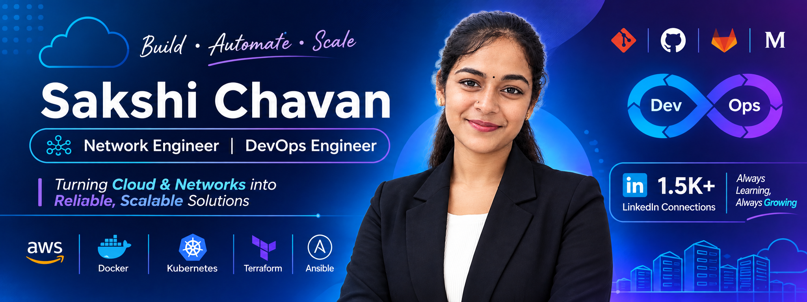
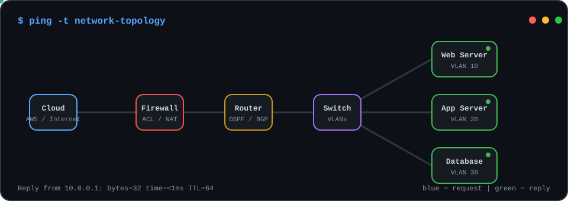

<div align="center">

# Hey Everyone 👋, I'm Sakshi Chavan



### DevOps & Cloud Engineer · Network Engineer


<a href="https://github.com/ByteHunterSakshi">
  
</a>
<a href="https://www.linkedin.com/in/sakshi-chavan-19659a2b3/">
  
</a>
<a href="https://medium.com/@sakshichavan1762004">
  
</a>

<br><br>


</div>

---

## 👩‍💻 About Me

<p>
  
 
  
</p>

<p>
  
  
</p>

I am a **B.Tech Computer Science graduate (2026)** from **Kolhapur, India**, passionate about **Cloud and DevOps**. I enjoy learning by building real projects around cloud infrastructure, automation, CI/CD and networking, and I write about what I learn on Medium.

### Currently Learning

<p>
  
  
  
  
  
  
</p>

- 👩‍💻 Projects: [github.com/ByteHunterSakshi](https://github.com/ByteHunterSakshi)
- 💬 Ask me about **Cloud, DevOps, Networking and CI/CD**
- ✍️ Blog: [Medium – Sakshi Chavan](https://medium.com/@sakshichavan1762004)
- 💼 LinkedIn: [Sakshi Chavan](https://www.linkedin.com/in/sakshi-chavan-19659a2b3/)

---

## `$ ls technologies/`

### Cloud, DevOps and Infrastructure

<p align="left">
  
</p>

### Development and Automation

<p align="left">
  
</p>

### DevOps Ecosystem

<p align="left">
  
  
  
  
</p>

---

## `$ ci/cd pipeline --run`

<p align="center">
  
</p>

---

## `$ ping -t network-topology`

<p align="center">
  
</p>

---

## `$ what --im-exploring`

```text
├── Linux and Shell Scripting
├── Git and GitHub
├── Docker and Containerization
├── Kubernetes
├── Terraform and Ansible
├── AWS Cloud Services
├── CI/CD with Jenkins and GitHub Actions
├── Monitoring with Prometheus and Grafana
├── Computer Networking
└── Python for DevOps
```

<p align="center">
  <a href="https://medium.com/@sakshichavan1762004">
    
  </a>
</p>

---

## `$ github --profile-summary`

<p align="center">
  
  
</p>

---

## `$ git streak`

<p align="center">
  
</p>

---

## `$ git log --graph --all`

<p align="center">
  
</p>

---

## 🤝 Open to Opportunities and Collaborations

<p>
  
  
  
</p>

## `$ connect --with-me`

<p align="center">
  <a href="https://www.linkedin.com/in/sakshi-chavan-19659a2b3/">
    
  </a>
  <a href="https://medium.com/@sakshichavan1762004">
    
  </a>
</p>

---

<div align="center">

### Learning cloud and DevOps by building, one project at a time.

```text
Build • Automate • Secure • Scale
```

**⭐ Follow [ByteHunterSakshi](https://github.com/ByteHunterSakshi) for my DevOps and cloud projects**

</div>
